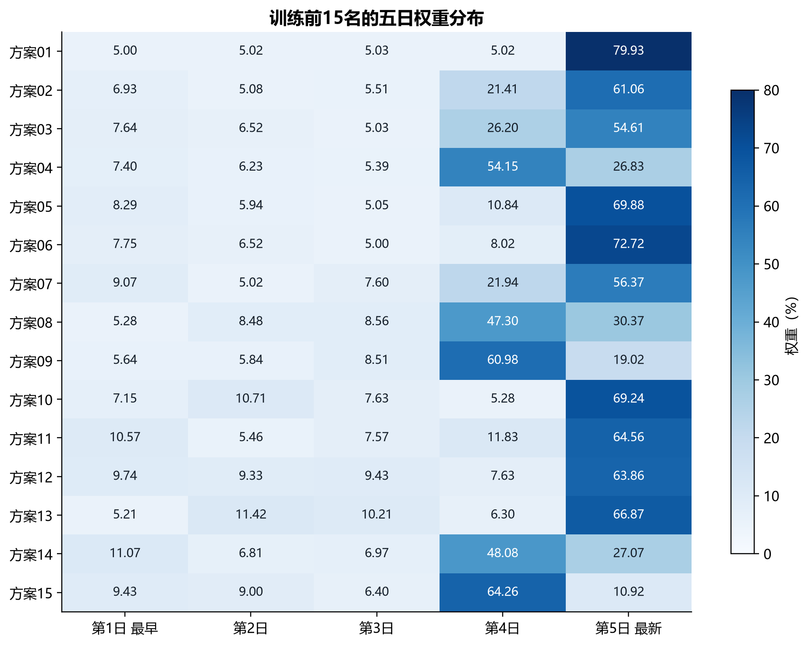
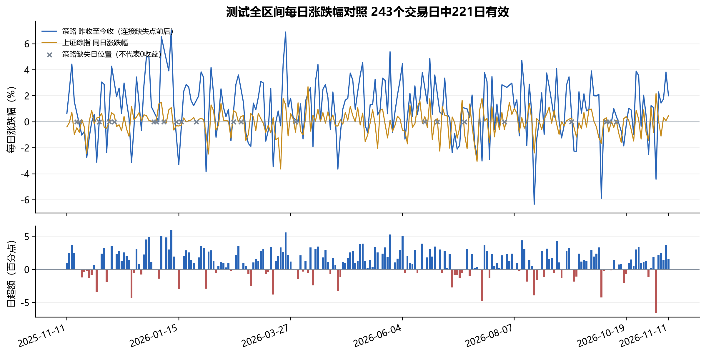
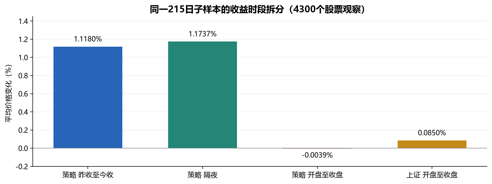

# A股五日相对市场优势 L

**一个从相对强势猜想出发，经过历史统计验证的短线上冲机会研究项目。**

我们研究的问题是：在中国A股中，最近几天相对于同期市场表现较强的股票，随后是否更容易出现短线上冲？

模型每天计算收益分布位置与标准化市场偏离，再对五日评分随机加权，选出综合得分最高的20只股票。现有结果体现出较突出的上冲机会识别价值，但**尚未证明实际交易能够获得同等收益**。这里的验证是特定A股历史样本上的探索性时间留出验证，不是未来收益保证或全市场普适性证明。

## 阅读研究报告

- **[在线阅读 PDF 完整论文](docs/paper.pdf)**：正式封面、章节分页、三线表、37个公式、13组图。
- [下载 Word 版本](docs/paper.docx)
- [阅读 Markdown 版本](paper.md)
- [五日优势独立计算代码](src/relative_strength_l/core.py)
- [运行代码与数据要求](CODE_GUIDE.md)
- [聚合结果数据与口径](DATA_DICTIONARY.md)

## 实验范围

| 项目 | 设置 |
|---|---|
| 研究市场 | 中国A股，现有3,052只股票历史样本 |
| 训练区间 | 2021-11-11至2025-11-10；训练尾部进行标签隔离 |
| 时间留出测试 | 2025-11-11至2026-11-11 |
| 权重搜索 | 1,000组随机候选，加等权、递增两组参考 |
| 入围结果 | 按训练排序保留15组，测试不重新排名 |
| 每期选股 | 五日综合评分前20只，等权评价 |
| 主要目标 | 未来五日峰值与三日触及5%的历史频率 |
| 当前阶段 | 理论建模、历史统计验证及代码公开 |

“适用范围”指模型的研究与检验场景。现有样本覆盖、存续偏差和成交约束仍有限制，尚不能推广为所有A股或其他市场均有效。

## 主要发现

我们把五日影响随机加权后发现，训练入围方案更偏重近期信息：前15名中有10组将最大权重分配给最近一天，最近两天的平均合计权重约78.17%。这是训练结果的经验偏好，不能解释成因果贡献率。

按原研究日期等权口径，方案01测试五日平均峰值约**11.09%**，同日市场约**4.95%**；三日触及5%的比例约**59.37%**，市场约**24.51%**。五日等权方案峰值已达约10.52%，说明核心强势筛选可能比精细权重优化更值得关注。



## 每日表现与上证综指

下图比较前一日收盘选股后的真实历史单日收盘涨跌幅，未扣交易费用，**不是累计净值**。策略有221个有效测试日期，22个缺失日期不补零；连接缺失点前后仅用于阅读。



测试有效日中，策略相对上证的日均差值约1.170个百分点，跑赢比例约74.21%。但该口径包含隔夜高开，信号完成后无法保证仍以昨收成交。

## 理论价值与实际收益的边界

完整五日股票窗口的峰值均值约11.05%，中位数约7.99%，说明值得继续检验的上冲机会确实存在于当前历史样本中。峰值表示窗口内曾出现的最高空间，不代表可预先知道的卖出价。



在相同215日、4,300个股票观察中，隔夜平均涨幅约1.1737%，开盘至收盘均值约−0.0039%。这说明机会识别优势不能直接转换为开盘跟进后的利润。

论文中的“峰值70%”资金曲线使用未来最高价，是事后情景；折扣与统一费用不能消除未来信息。后段数据曾在此前研究中被查看，因此不是全新盲测。完整退市池、复权、缺失报价、流动性与成交约束仍需继续核验。

## 代码范围与运行

本仓库仅提取与五日相对优势有关的计算函数：每日P/Z评分、五日窗口、约束随机权重、训练排序、时间隔离与未来机会标签。提供标准CSV入口及测试，不依赖桌面应用或其他策略。

```bash
python -m pip install -e .
python -B -m unittest discover -s tests -v
python examples/research_from_csv.py local_data/stocks.csv --asof 2026-11-11 --output runs/research
```

需自行提供符合要求的行情；仓库只附聚合结果，不包含原始个股行情。现有图表来自已冻结实验，新数据运行不保证复现相同数值。详见[代码说明](CODE_GUIDE.md)。

## 研究贡献与下一步

本项目将直观的相对优势想法转化为明确公式，完整展示训练前15名，并区分每日价格表现、未来上冲空间与事后资金情景。理论与统计价值在于可核验的机会识别，而非宣称已经得到稳定盈利策略。

后续将冻结模型，在新增数据中比较纯单日、五日等权和优化权重，并研究信号形成后可成交时点、预设退出、风险与成本。欢迎通过 Issues 讨论计算逻辑、数据口径及改进建议。

技术溯源单独保存在[evidence/provenance.json](evidence/provenance.json)。

