# 五日相对市场优势模型的构建与历史验证

从横截面评分到短线上冲机会的探索性研究

研究范围说明：本文研究对象为中国A股现有3,052只股票的历史样本。结论限于所列样本与实验口径，尚未证明对全部A股、其他市场或真实交易收益普遍成立。

## 摘要

我们提出一个可检验的猜想：若一只股票在最近若干交易日中，相对于同期股票市场保持较强表现，那么它在随后短期内可能更容易出现上冲机会。为避免仅用个股涨幅减去市场平均涨幅描述优势，我们将同日收益分布位置与标准化偏离相结合，形成每日相对得分，再对连续五日评分进行约束随机加权，选择综合得分最高的20只股票。研究以3,052只股票的现有行情为基础，用前四年进行权重搜索，在后一年按冻结参数进行时间留出验证；搜索比较1,002组权重，保留训练排名前15的方案，并完整展示其权重和后段表现。

结果显示，训练第一名的最近一天权重约为79.93%；前15名中有10个方案将最大权重分配给最近一天，最近两天的平均合计权重为78.17%。这说明在当前股票样本、评分公式及训练目标下，近期信息更受搜索过程偏好。第一方案在测试段221个有效日期的日均收盘涨幅为1.142%，相对同期上证综指的日均差值为1.170个百分点，跑赢比例为74.21%。按完整股票窗口统计，五日峰值均值为11.051%，中位数为7.993%，市场篮子的峰值均值为4.948%。但在能够进一步对齐的215日子样本中，隔夜平均涨幅为1.1737%，开盘至收盘平均涨幅为−0.0039%，说明显著的单日优势主要发生于下一次开盘之前。

我们据此将模型定位为短线相对强势与上冲机会的筛选器，而不将历史峰值或峰值70%的事后资金情景解释为可实现利润。论文明确区分特征、未来标签、日期等权统计、股票观察统计和资金情景，报告样本覆盖、简单基准、条件不确定性及尚未验证的执行限制。结果支持继续研究该方向，但对五日聚合的独立增量和信号形成后可兑现的净收益，仍需冻结规则后在新增数据上检验。

关键词　相对市场强度　收益分布位置　五日加权　短线上冲　时间留出验证

## 一 研究出发点与模型定位

### 1 从绝对涨跌转向同期相对优势

我们的出发点不是寻找固定形态，也不是预先规定某只股票应该上涨多少，而是比较个股与同期市场的关系。市场普涨时，个股上涨可能只是共同趋势的一部分；市场下跌时，跌得较少也可能属于相对强势。因此，模型首先回答“这只股票相对于当天其他股票有多强”，再检验这种强度是否与未来短线表现存在联系。相对强势是当前可观察的状态，未来上涨则是需要检验的结果，两者不能在定义上画等号。

最直接的做法是用个股收益减去市场平均收益。它保留了领先幅度，却忽略同日分布的疏密：领先两个百分点，在普遍涨跌接近的日子可能很突出，在股票表现高度分化的日子则未必如此。我们因此引入收益分布位置 P 和标准化偏离 Z。前者回答“超过了多少同日股票”，后者回答“领先幅度相对于市场分散程度有多大”。二者仍源自收益率，不是两个独立的数据来源；模型改善来自信息表达，而不是凭空增加信息。

我们坚持每天单独计算相对得分，然后综合五天，而不是仅比较五日累计涨幅。这样可以显式研究近期信息与较早信息的相对作用，也允许通过等权、递增权重和随机权重比较，检验时间分配是否带来增量。五天是本轮实验的观察窗口，不代表理论上唯一正确的期限，更不代表每只入选股票五天内每天都跑赢市场。

### 2 三个层次的研究问题

第一层是状态识别：评分能否把当日或近期明显强于市场的股票排在前列？它可以通过计算逻辑和同日排序核验。第二层是机会识别：入选股票在未来三至十个交易日内，是否有更高的上冲空间或目标触及频率？它需要未来标签与市场基准比较。第三层是交易兑现：在信号形成后能够取得的价格和成交条件下，事先固定的退出规则能否产生扣费后的有利结果？它需要严格的执行回测。

当前报告主要完成前两层的历史验证，并通过时段拆分检查第三层的关键障碍。我们不把较高峰值直接写成“模型预计能够赚到同样比例”。本文所称预估表现，是历史条件下的样本估计，不是对下一只股票、下一个月或未来年度的收益承诺。

### 3 与已有动量研究的关系

经典相对强弱与动量研究为“历史表现排序可能包含后续信息”提供了研究背景。Jegadeesh 与 Titman 的研究讨论了买入过去赢家、卖出过去输家的策略及三至十二个月持有期[1]。French 数据库的动量组合使用过去第十二月至第二月的收益并按月构建组合[2]。本研究使用五个交易日、每日横截面评分和短线上冲标签，与上述周期和组合构造不同，因此不能直接借用经典论文的收益结论作为本模型已被证实的依据。

参数搜索还需要面对回测过拟合。Bailey 等讨论了在投资回测中评估过拟合概率的问题[3]。我们没有在本报告中声称完成该文提出的完整检验，而是据此区分训练搜索、后段检查和真正未见数据验证，并披露重复查看历史结果的限制。

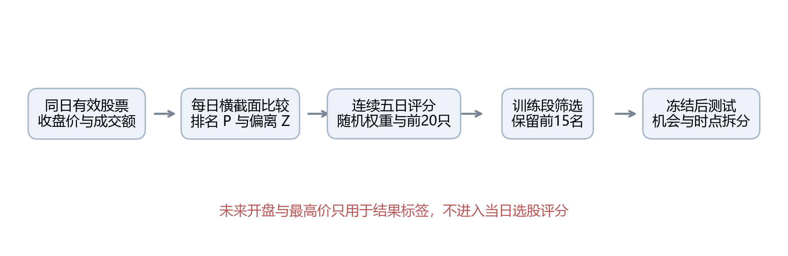

图1　流程中的评分仅使用信号时点及此前信息；未来开盘和最高价用于构造结果标签。图为计算流程示意，不代表新的行情实验。

## 二 数据范围与变量定义

### 1 数据规模和时间范围

本次研究的现有股票数据集合包含3,052只股票，缓存覆盖2021年8月24日至2026年11月11日。早于正式研究起点的数据可以提供滚动计算所需的历史上下文，不能把全部缓存日期都算作有效训练观察。正式训练区间为2021年11月11日至2025年11月10日，后段测试区间为2025年11月11日至2026年11月11日。数据来源为既有本地日线行情集合；本报告没有据此验证供应商覆盖全部历史上市及退市股票的完整性。

数据集中具备常规开高低收、成交相关指标和五类指数。当前评分真正使用的是收盘价和成交额正值条件；开盘价、最高价用于结果评估。量比、成交量、最低价和其他指标并没有因为存在于数据中就自动进入本轮公式。明确“实际使用”和“可供以后使用”的区别，是复现模型的必要条件。

表1　输入数据字典

| 字段 | 符号 | 本轮用途 | 单位与可用时点 |
|---|---|---|---|
| 交易日期 | t | 排序、连接、滚动窗口与区间划分 | 按交易日序列；不是自然日加减 |
| 股票代码 | i | 唯一识别、同日排序与边界同分处理 | 字符串；保留前导零 |
| 收盘价 | Cᵢₜ | 日收益、相对评分与收盘表现 | 同一调整口径的价格；收盘后完整 |
| 开盘价 | Oᵢₜ | 次日参考入场价和隔夜拆分 | 同一调整口径的价格；次日开盘才知道 |
| 最高价 | Hᵢₜ | 三日、五日、十日未来峰值标签 | 对应交易日结束后完整，不进入选股 |
| 成交额 | Vᵢₜ | 当日有效样本要求 V>0 | 保留原始金额单位，仅用于正值判断 |
| 指数开盘与收盘 | Oᴵₜ Cᴵₜ | 同日上证对照和时段拆分 | 指数点位；收益转换后为无量纲 |
| 指数最高价 | Hᴵₜ | 同口径峰值情景对照 | 点位；未来标签 |
| 最低价、成交量、量比 | 本轮未入模 | 可用于后续风险和流动性实验 | 不计入当前评分或搜索 |

五类指数为上证综指、深证成指、沪深300、中证500和中证1000；本文主图固定使用上证综指，不在看到结果之后切换更有利的指数。模型评分中的“市场”是有效股票横截面，而不是上证指数。前者用于刻画个股的相对状态，后者用于呈现外部价格参考，两者权重和成分不同。

### 2 样本可用性和统计单位

我们区分三个集合：当日可以计算收益的股票集合、连续五日评分完整的候选集合，以及从候选中选出的20只股票集合。每日市场均值和标准差来自第一个集合；五日排序使用第二个集合；未来表现评价针对第三个集合。未来标签缺失时，不反过来改写当日选股结果，而是在对应评价指标中记录缺失。

表2　不同评价层次的有效样本数量

| 统计层次 | 训练段 | 测试段 | 解释 |
|---|---:|---:|---|
| 每日曲线区间交易日 | 969 | 243 | 以表现日期计数 |
| 每日组合完整有效日 | 916 | 221 | 所选成员报价均完整 |
| 每日组合缺失日 | 53 | 22 | 不补零，不进入日均与胜率 |
| 原权重研究有效日期字段 | 958 | 238 | 对应原信号与标签统计，不等同主图日数 |
| 当前情景已结算股票观察 | 19,206 | 4,717 | 同股不同信号可重复出现 |
| 当前完整五日峰值观察 | 19,093 | 4,664 | 五日最高价完整 |
| 当前十日峰值有效观察 | 18,917 | 4,567 | 十日标签要求更长数据 |
| 当前三日触及有效观察 | 19,150 | 4,688 | 单独使用三日窗口 |

表2中的数量不能互相替代。训练尾部隔离、信号日期与表现日期错位、窗口是否完整、情景是否已经结算，都会改变分母。原权重研究方案01的测试五日峰值观察为4,684个，当前指数对照中的完整窗口为4,664个；我们在十五方案对比中统一使用前者来源，在当前峰值分布中统一使用后者来源，避免拼接不同口径。

## 三 每日相对优势的数学构造

### 1 收益率与有效参照组

以下以 i 表示股票、t 表示交易日，所有收益率计算使用小数，例如3%写为0.03。日期 t−1 指前一个交易日。记 finite 为数值有限，定义日收益率及基本可用条件：

$$r_{i,t}=\frac{C_{i,t}}{C_{i,t-1}}-1$$

$$e_{i,t}=\mathbf{1}\{r_{i,t}\ \mathrm{finite},\ C_{i,t}>0,\ V_{i,t}>0\}$$

$$\mathcal{U}_t=\{i:e_{i,t}=1\},\quad \mathcal{M}_{i,t}=\mathcal{U}_t\setminus\{i\},\quad n_{i,t}=|\mathcal{M}_{i,t}|$$

实际实现用不向前填充的相邻收盘价变化计算收益。参照组排除股票自身，使个股不会通过改变市场均值而部分稀释自己的相对优势；每只参照股票等权，不按流通市值加权。要求 n 至少为500，意味着有效横截面至少有501只包含当前股票的样本。

### 2 市场均值和离散程度

$$\mu_{i,t}=\frac{1}{n_{i,t}}\sum_{j\in\mathcal{M}_{i,t}}r_{j,t}$$

$$\sigma_{i,t}=\sqrt{\frac{\sum_{j\in\mathcal{M}_{i,t}}(r_{j,t}-\mu_{i,t})^2}{n_{i,t}-1}}$$

$$L_{i,t}=r_{i,t}-\mu_{i,t},\qquad Z_{i,t}=\frac{L_{i,t}}{\sigma_{i,t}}$$

L 保留直观的涨幅差，Z 把差值转换为同日横截面标准差单位。若参照标准差低于10⁻⁶，则不计算 Z，避免近零分母放大数值噪声。这里的标准差不是个股自身历史波动，也不是对行业、市值或风险因子进行回归后的残差，因此不能把 Z 解释成已经完成风险中性化的超额收益。

为提高计算效率，代码可以使用同日总和与平方和一次性获得每只股票的剔除自身统计，数学上与逐只构造参照组等价：

$$T_t=\sum_{j\in\mathcal{U}_t}r_{j,t},\quad Q_t=\sum_{j\in\mathcal{U}_t}r_{j,t}^2,\quad \mu_{i,t}=\frac{T_t-r_{i,t}}{n_{i,t}}$$

$$\sigma_{i,t}^2=\frac{Q_t-r_{i,t}^2-n_{i,t}\mu_{i,t}^2}{n_{i,t}-1}$$

浮点运算下，理论上非负的方差可能出现极小负值，实现将其下限截为零，再进行标准差门槛检查。该处理是数值稳定措施，不是对股票收益作截尾或修改。

### 3 收益分布位置

$$P_{i,t}=\frac{\sum_{j\in\mathcal{M}_{i,t}}\mathbf{1}\{r_{j,t}<r_{i,t}\}+\frac{1}{2}\sum_{j\in\mathcal{M}_{i,t}}\mathbf{1}\{r_{j,t}=r_{i,t}\}}{n_{i,t}}$$

P 介于0与1之间，采用并列中间排名。同日若有多只股票涨幅相同，它们得到相同分布位置；不能把股票代码顺序当作强弱差异。代码也可以先求包含自身的平均秩 rank，再按下式转换，得到与剔除自身相同的结果：

$$P_{i,t}=\frac{\mathrm{rank}_{\mathrm{average}}(r_{i,t})-1}{|\mathcal{U}_t|-1}$$

排名位置对极端幅度较不敏感，Z 则保留距离信息。两者互补的程度需要实验，而不能仅由定义证明。若未来发现只用 P 即可达到同样效果，应优先保留更简单的模型。

### 4 每日综合评分

$$g(z)=\frac{1+\tanh(z/2)}{2}$$

$$S_{i,t}=100\left[0.7P_{i,t}+0.3g(Z_{i,t})\right]$$

g 将极端偏离压缩到0与1之间，P 和 g 因而可以在相近尺度上组合。70%与30%是本轮固定规则，搜索只改变五个交易日的时间权重，没有同时优化这两个系数。得分不是概率，也没有经过概率校准。

例如，个股上涨3%、参照平均上涨1%、标准差为2%，则 L=2个百分点、Z=1。若 P=0.9，每日得分约84.93。该示例只解释公式，不来自真实样本；84.93分不等于未来上涨概率84.93%。

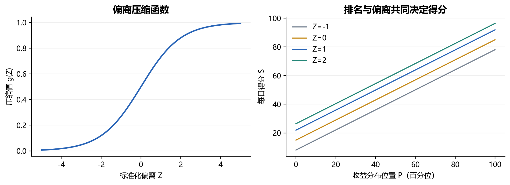

图2　左图展示偏离压缩函数，右图展示固定 Z 时每日评分与 P 的关系。两图是公式的确定性图示，不是历史拟合曲线。

## 四 五日聚合与随机权重搜索

### 1 五日窗口与排名

$$\mathcal{U}^{(5)}_t=\{i:S_{i,t-k}\ \mathrm{finite}\ \mathrm{for}\ k=0,1,2,3,4\}$$

$$A_{i,t}(w)=\sum_{d=1}^{5}w_dS_{i,t-5+d}$$

$$\sum_{d=1}^{5}w_d=1,\qquad w_d\geq0.05$$

$$\mathcal{B}_t(w)=\mathrm{Top}_{20}\{A_{i,t}(w):i\in\mathcal{U}^{(5)}_t\}$$

第1日是最早的一天，第5日是信号日。每一天至少5%，因此单日最多80%，不包含某一天100%的候选。缺失分数不补齐。边界同分时采用固定代码顺序，使同一输入能够得到一致输出；这是确定性处理，不代表代码顺序具有经济含义。若候选不足20只，不能把不足数量的篮子伪装成正常20只日收益。

综合排名没有附加“每日必须高于市场”这一门槛。该选择保留研究初衷中对综合相对优势的关注，但也意味着入选可能由最近一天突出表现主导。模型的名称描述观察窗口，不能替代对持续性的单独证明。

### 2 候选权重如何生成

$$u^{(m)}\sim\mathrm{Dirichlet}(\alpha,\alpha,\alpha,\alpha,\alpha),\qquad w^{(m)}=0.05\mathbf{1}+0.75u^{(m)}$$

1,000组随机候选分成334、333、333组，分别使用 α=0.5、1、2。较小的 α 允许更集中权重，较大的 α 倾向较分散权重。固定随机种子为20261112。再加入五日等权和线性递增权重两组参考，共得到1,002组；随机搜索不是遍历连续权重空间，因此“第一名”仅指本次候选集合和训练目标下的最优者。

$$w^{\mathrm{equal}}=(0.2,0.2,0.2,0.2,0.2),\qquad w^{\mathrm{linear}}=\frac{(1,2,3,4,5)}{15}$$

### 3 训练目标与保留规则

训练首先评价五日峰值相对同日市场篮子的提升，再用三日触及比例提升、峰值70%辅助情景收益作依次同分比较，最后按候选编号确定顺序。这里不是把多个指标加权成一个未经说明的黑箱分数。设日期 t 的选股峰值均值为 F̄ᴮₜ，市场均值为 F̄ᴹₜ，则主要目标为：

$$J_5(w)=\frac{1}{|\mathcal{T}_5(w)|}\sum_{t\in\mathcal{T}_5(w)}\left[\bar F^B_{5,t}(w)-\bar F^M_{5,t}\right]$$

$$J_3(w)=\frac{1}{|\mathcal{T}_3(w)|}\sum_{t\in\mathcal{T}_3(w)}\left[\bar Y^B_{3,t}(w)-\bar Y^M_{3,t}\right]$$

集合 T₅、T₃分别表示对应差值可计算的训练日期。每个日期先对有完整标签的股票求均值，再对日期等权，不将未来标签是否存在用于事前评分。缺失标签仍可能带来结果选择偏差，因此必须报告其数量。

保留前15名后，我们不按第五年成绩重新排序。第一名是一个明确的展示对象，不是看到第五年后再挑出的测试赢家。保留全部15名，使读者能观察结果是否只靠单个幸运参数，亦能看到相近训练表现对应的不同权重配置。原记录保留了候选总数、生成规则和前15名结果；本文不虚构未保留的1,002组完整评分分布。

## 五 时间划分与验证实施

### 1 严格区分信号时间和标签时间

完整日线在 t 日收盘后才可获得，模型由截至 t 日的五日数据形成 Bₜ。次日开盘 Oᵢ,ₜ₊₁用于参考入场，未来最高价用于评估。代码必须先完成训练和权重冻结，才构造测试结果；对评分、特征和权重而言，不得使用 t 之后的行情。

训练区间虽截止2025年11月10日，最后一个可用于本轮权重拟合的信号日期为2025年10月24日。实现对训练尾部采用保守隔离，要求最长评价标签能够在训练区间内部完成，并将构造训练标签的价格数组物理截断在测试起点之前。特征进入测试期时可以使用当时已经发生的训练末期价格，这属于合法历史上下文。

表3　训练与测试实施顺序

| 阶段 | 日期或规模 | 实际操作 |
|---|---|---|
| 行情上下文 | 最早2021-08-24 | 为滚动评分准备历史，不全计为训练 |
| 训练区间 | 2021-11-11至2025-11-10 | 仅使用该段完整可观察标签选权重 |
| 训练最后信号 | 2025-10-24 | 尾部隔离防止窗口标签跨界 |
| 参数搜索 | 1,002组 | 固定评分公式，只搜索五日权重 |
| 候选保留 | 前15名 | 以训练排序冻结，不按后段重排 |
| 测试区间 | 2025-11-11至2026-11-11 | 沿用冻结权重与选股规则 |
| 结果核验 | 既有逐日、逐笔与汇总结果 | 检查分母、价格时点与指标一致性 |

第五年未参与本次权重拟合，并不意味着所有研究选择均独立于第五年。该时间段已在此前研究过程中被查看，指标和功能也曾被讨论，因此本报告使用“时间留出验证”而不声称全新盲测。训练代码层面的隔离与研究者反复查看历史，是两个需要分别处理的问题。

### 2 计算逻辑的可读描述

```text
输入：按日期与代码对齐的收盘价、成交额、开盘价、最高价
逐日：计算收益 → 有效参照组 → 排名 P 与偏离 Z → 得分 S
滚动：仅保留五日评分完整的股票，建立五日得分窗口
训练：生成固定种子的1002组权重，逐组计算综合分并选前20只
评价：在训练内部计算峰值与触及标签，比较同日市场篮子
冻结：按训练目标保留15组，保存权重和训练顺序
测试：沿用各组权重，计算后段日表现、峰值与触及频率
核验：比较有效分母，拆分隔夜与日内，检查缺失和聚合口径
```

上述伪代码描述真实实现的职责划分，并不是可直接运行的完整回测程序。计算时还需要确定交易日历、字段类型、重复记录处理、异常价格规则和历史数据版本。指标定义清楚之后再写代码，可以降低“程序运行成功但计算的是另一个问题”的风险。

## 六 未来标签与评价指标

### 1 峰值和触及事件

$$E_{i,t}=O_{i,t+1},\qquad F_{i,t}^{(h)}=\frac{\max_{1\leq k\leq h}H_{i,t+k}}{E_{i,t}}-1$$

$$Y_{i,t}^{(3)}=\mathbf{1}\{F_{i,t}^{(3)}>0.05\},\qquad U_{i,t}=\mathbf{1}\{C_{i,t+1}>C_{i,t}\}$$

h取3、5、10，窗口包括参考买入日。最高价必须在完整窗口内存在，缺失时该标签记为空；样本尾部没有足够未来日期，也不记成失败。触及5%采用严格超过，边界存在数值精度处理。U 是次日收盘相对前收盘上涨的指标，不是开盘买入后盈利的指标。

设 Kₜ,h 为信号日 t 入选且 h 日标签完整的股票子集，则日期内及跨日期聚合为：

$$\bar F^B_{h,t}=\frac{1}{|K_{t,h}|}\sum_{i\in K_{t,h}}F_{i,t}^{(h)},\qquad \widehat{F}^{\mathrm{date}}_h=\frac{1}{|\mathcal{T}_h|}\sum_{t\in\mathcal{T}_h}\bar F^B_{h,t}$$

$$\widehat{F}^{\mathrm{obs}}_h=\frac{\sum_t\sum_{i\in K_{t,h}}F_{i,t}^{(h)}}{\sum_t|K_{t,h}|}$$

前一个是原权重研究使用的日期等权结果，后一个是当前已结算完整股票窗口的观察平均。有效股票数不同、边界日期不同，两者不必完全相等。我们明确保留这种差异，而不通过任意补齐使数字强行一致。

### 2 每日相对曲线

$$R^B_t=\frac{1}{20}\sum_{i\in\mathcal{B}_{t-1}}\left(\frac{C_{i,t}}{C_{i,t-1}}-1\right),\qquad R^I_t=\frac{C^I_t}{C^I_{t-1}}-1$$

$$D_t=R^B_t-R^I_t$$

只有20只入选成员的前后收盘报价全部有效时，Rᴮₜ才进入统计；缺失成员不会被删除后重新分配权重。D 是同日百分点差，不是资金净值。图中将有效点连接以便阅读，缺失位置单独标记，连接部分不生成新的观察值。

$$\bar D=\frac{1}{N}\sum_{t\in\mathcal{V}}D_t,\qquad p_{\mathrm{beat}}=\frac{1}{N}\sum_{t\in\mathcal{V}}\mathbf{1}\{D_t>0\}$$

$$s_B=\sqrt{\frac{\sum_{t\in\mathcal{V}}(R^B_t-\bar R^B)^2}{N-1}},\qquad \mathrm{coverage}=\frac{N}{T}$$

V 是策略与指数共同有效日期集合，N为其数量，T为所评区间交易日总数。均值、跑赢比例和标准差均在匹配日期上计算。指数本身拥有完整数据，也不能在平均比较时使用更多日期而造成错配。

### 3 隔夜和日内的分解

$$G_{i,t}=\frac{O_{i,t}}{C_{i,t-1}}-1,\qquad Q_{i,t}=\frac{C_{i,t}}{O_{i,t}}-1$$

$$1+r_{i,t}=(1+G_{i,t})(1+Q_{i,t})$$

必须先在相同股票、相同日期上分解，再求组合平均。隔夜均值与日内均值不能机械相加代替总体均值，因为存在乘积交叉项。此处 Q 只是开盘到收盘的价格变化，不假定能够当日买入并卖出。

### 4 峰值70%情景与资金记账

$$P^{\mathrm{exit}}_{i,t}=E_{i,t}\left(1+0.7F_{i,t}^{(5)}\right)$$

$$R^{\mathrm{scenario}}_{i,t}=\left(1+0.7F_{i,t}^{(5)}\right)(1-c)^2-1,\qquad c=0.001$$

例如100元入场、未来最高111元，情景参考退出价是107.7元，而不是77.7元。每边0.1%的统一费用只是实验参数，不是完整现实费率模型；没有覆盖所有滑点、冲击和成交约束。70%折扣仍然依赖未来最高价，无法消除未来信息。

资金划为五份轮动，每批最多使用初始本金的20%，一批股票等权分配。完整五日窗口之后统一结算，未结算资金不重复使用。默认固定本金模式把正利润转入留存，不持续扩大下一批本金；需要时可用留存补充本金不足。期间未结算持仓按入场成本记账，记账曲线为：

$$V_t^{\mathrm{book}}=\sum_{s=1}^{5}\mathrm{cash}_{s,t}+\mathrm{reserve}_t+\sum_{b\in\mathrm{pending}_t}\mathrm{costbasis}_b$$

这一曲线不包含持仓浮亏，不能用它近乎平滑的回撤表示真实交易风险。入场缺失时保留对应现金；最高价部分缺失时，情景使用已观察最高价与入场价中的较大值，单列完整性。该值只是相对于当前已观察价格的事后下界，不是未知真实执行收益的保证。

## 七 前十五名权重与训练结果

### 1 全部入围权重

我们把五日影响随机加权后发现，训练表现较好的方案通常更偏重最近两天。第一名五日权重约为5.0005%、5.0191%、5.0254%、5.0231%和79.9318%。它接近搜索约束的边界，说明本轮目标倾向最近一天，但也提示需要进行参数敏感性与单日对照，而不是把边界解当作普适最优。

表4　训练前十五名的五日权重　单位为百分比

| 训练名次 | 第1日 | 第2日 | 第3日 | 第4日 | 第5日 |
|---|---|---|---|---|---|
| 01 | 5.00 | 5.02 | 5.03 | 5.02 | 79.93 |
| 02 | 6.93 | 5.08 | 5.51 | 21.41 | 61.06 |
| 03 | 7.64 | 6.52 | 5.03 | 26.20 | 54.61 |
| 04 | 7.40 | 6.23 | 5.39 | 54.15 | 26.83 |
| 05 | 8.29 | 5.94 | 5.05 | 10.84 | 69.88 |
| 06 | 7.75 | 6.52 | 5.00 | 8.02 | 72.72 |
| 07 | 9.07 | 5.02 | 7.60 | 21.94 | 56.37 |
| 08 | 5.28 | 8.48 | 8.56 | 47.30 | 30.37 |
| 09 | 5.64 | 5.84 | 8.51 | 60.98 | 19.02 |
| 10 | 7.15 | 10.71 | 7.63 | 5.28 | 69.24 |
| 11 | 10.57 | 5.46 | 7.57 | 11.83 | 64.56 |
| 12 | 9.74 | 9.33 | 9.43 | 7.63 | 63.86 |
| 13 | 5.21 | 11.42 | 10.21 | 6.30 | 66.87 |
| 14 | 11.07 | 6.81 | 6.97 | 48.08 | 27.07 |
| 15 | 9.43 | 9.00 | 6.40 | 64.26 | 10.92 |

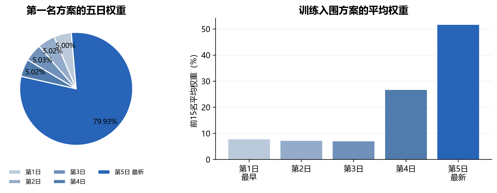

图3　扇形图只表示权重份额，不表示收益来源比例。右图汇总前十五名的平均权重，避免仅依赖第一名判断时间作用。

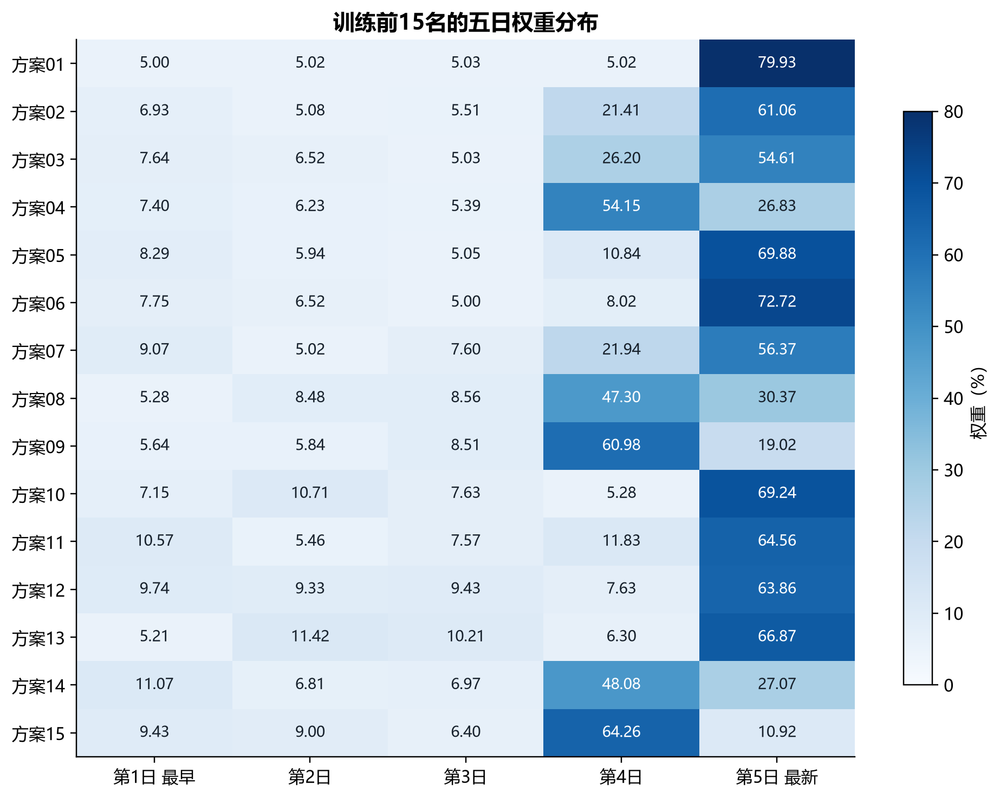

图4　各行保持训练排名，颜色与单元格均为权重百分比。15组中10组的最大权重在第5日，其余5组在第4日；第5日平均权重约51.55%，中位数约61.06%，第4与第5日合计均值约78.17%。

这些结果更适合表述为“当前训练目标偏好近期信息”，不宜写成“最近一天导致未来上涨”。搜索中的权重大小不是因果效应，也不是单个因子贡献率。因为五日评分相关，模型可以通过不同权重表达相似排序；统计检验仍需考察调整某一天是否带来稳定的预测增量。

### 2 保持训练顺序展示后段成绩

表5　全部十五个方案的训练与测试表现　收益和比例单位为百分比

| 训练名次 | 训练峰值% | 测试峰值% | 测试峰值差¹ | 三日触及% | 次日上涨% | 峰值观察数 |
|---|---|---|---|---|---|---|
| 01 | 11.379 | 11.089 | 6.136 | 59.37 | 53.96 | 4684 |
| 02 | 11.373 | 11.221 | 6.268 | 60.35 | 53.49 | 4685 |
| 03 | 11.342 | 11.226 | 6.273 | 60.39 | 53.12 | 4684 |
| 04 | 11.255 | 11.194 | 6.241 | 60.59 | 52.14 | 4684 |
| 05 | 11.234 | 11.008 | 6.055 | 59.41 | 53.17 | 4679 |
| 06 | 11.226 | 11.021 | 6.068 | 59.17 | 53.46 | 4681 |
| 07 | 11.226 | 11.083 | 6.130 | 59.93 | 52.40 | 4684 |
| 08 | 11.210 | 11.096 | 6.143 | 60.51 | 52.16 | 4688 |
| 09 | 11.204 | 11.138 | 6.185 | 60.63 | 51.14 | 4688 |
| 10 | 11.091 | 10.885 | 5.932 | 58.60 | 52.55 | 4683 |
| 11 | 11.082 | 10.916 | 5.963 | 59.09 | 52.32 | 4678 |
| 12 | 11.076 | 10.920 | 5.967 | 59.00 | 52.17 | 4678 |
| 13 | 11.053 | 10.875 | 5.922 | 58.71 | 52.57 | 4686 |
| 14 | 11.052 | 11.005 | 6.052 | 59.80 | 51.32 | 4682 |
| 15 | 11.047 | 11.070 | 6.117 | 60.13 | 50.48 | 4683 |

¹ 峰值差单位为百分点，其他收益和比例列为百分比。

表5的峰值与概率均沿用原权重研究的日期等权聚合；训练峰值不是排序时唯一依据，主要排序目标是相对同日市场的峰值差。编号01至15表示训练顺序，不代表第五年高低。所有方案均使用相同固定的评分公式和20只选择规则。

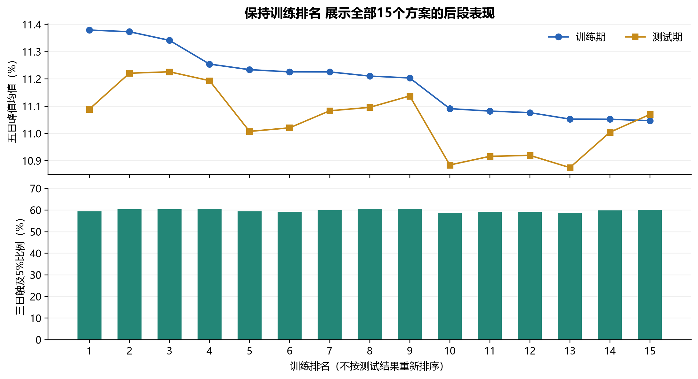

图5　上图对照两段五日峰值，下图展示后段三日触及比例。训练第一名不是后段峰值最高者，不能为了改善展示而将后段最佳者追认成事前选定方案。

前15名后段五日峰值约在10.87%至11.23%之间，差距相对它们与市场的差距较小。这提示主要效果可能来自相对强势筛选本身，而时间权重的精细优化只贡献一部分改善。另一方面，十五组都从同一次训练搜索中选出，不能把它们当作十五次完全独立的成功实验。

## 八 真实每日曲线与市场对照

### 1 全区间与局部观察

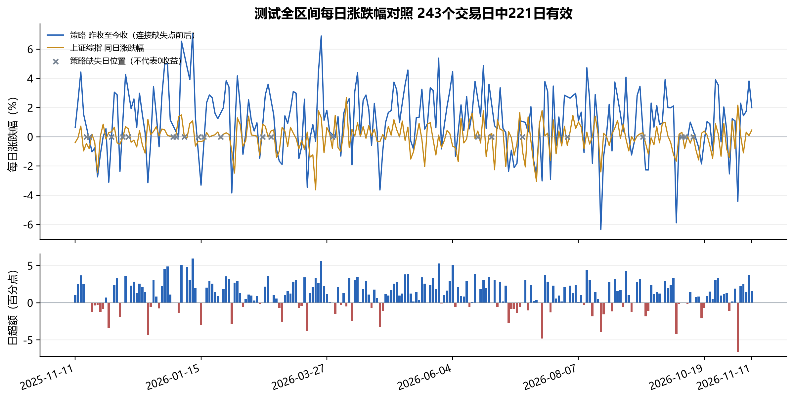

图6　蓝线为前一日冻结篮子的当日收盘涨跌，金线为上证同日涨跌。下方为两者百分点差。灰色叉号标记策略缺失日期的位置，不表示收益为零；连线仅辅助观察，不对缺失日插值入账。

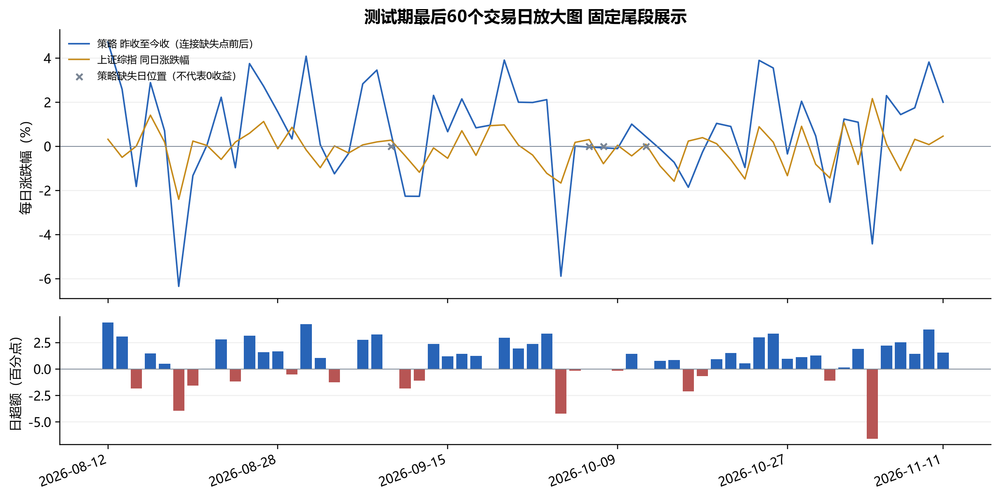

图7　固定展示样本末尾60个交易日，不按优劣挑选局部。放大图沿用与全图相同的计算定义，用于辨认两条曲线的相对关系。

表6　同日期单日表现统计

| 指标 | 训练段 | 测试段 |
|---|---|---|
| 日均涨跌 | 1.206% | 1.142% |
| 同日上证日均涨跌 | 0.020% | -0.028% |
| 日均超额 | 1.187个百分点 | 1.170个百分点 |
| 跑赢比例 | 72.271% | 74.208% |
| 组合上涨日比例 | 71.943% | 72.398% |
| 组合单日标准差 | 2.368% | 2.246% |
| 上证单日标准差 | 1.022% | 0.958% |
| 最差单日 | -6.438% | -6.348% |

测试日均超额约1.170个百分点，跑赢日期占74.21%，组合上涨日期占72.40%。这些数字说明该历史篮子具有明显相对强势，但不是“每只股票有74.21%的概率上涨”。组合上涨按日期统计，单股上涨按股票观察统计，跑赢又允许双方同时下跌而策略跌得较少。将三者混写会夸大模型含义。

测试组合单日标准差约2.246%，上证约0.958%，波动比例约2.34倍；最差单日篮子约−6.35%，最好约7.06%。因此，优势并不表现为每天稳定小幅获利，也不能仅靠均值判断承担的风险。

### 2 月份稳定性与覆盖情况

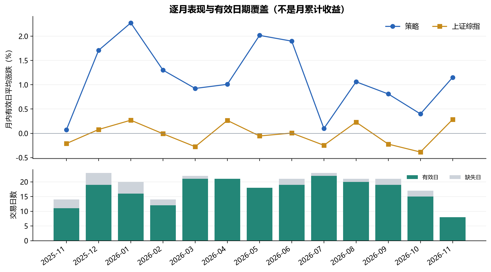

图8　上半部分按每个月内共同有效日期计算日均涨跌，不是月累计收益；下半部分显示完整与缺失日期。首尾月份不完整，2026年11月只覆盖至11日。

我们保留全部月份，而不是只展示最好区间。月内相对优势的大小存在变化，部分月份策略均值接近零，显示结果具有市场环境依赖。按季度拆分、不同市场状态分组或加入风险暴露控制，是后续稳健性分析的方向；当前全区间均值不能证明所有状态下都同样有效。

每日图仍采用昨收至今收口径，包含次日高开。信号在昨收后形成，昨收并非可保证成交价，因此我们不把该日序列直接累乘成年化收益。如果未来需要可执行净值，应以真实可用的成交时点、持仓及退出规则重新构造，而不能只给这条线换个标题。

## 九 上冲机会与简单基准

### 1 优化权重与五日等权的差别

为了区分选股逻辑本身与时间权重优化的作用，我们在同一后段区间比较优化方案、五日等权和同日市场篮子。三者使用相同的未来窗口和参考价格定义，均先在日期内平均、再对日期等权。图中的高低因此描述机会差异，不表示资金收益差异。

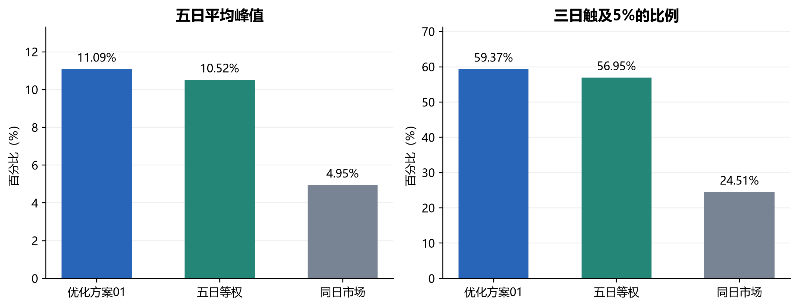

图9　统一采用原权重研究的后段日期等权结果。方案01五日峰值为11.089%，五日等权为10.523%，同日市场为4.953%；三日触及率分别约59.37%、56.95%、24.51%。

优化相较五日等权的五日峰值增量约0.566个百分点，远小于相对市场的整体差。这说明“相对强势筛选有用”和“精细时间权重优化有用”是两个不同命题。当前证据对前者更直接；后者需要对逐日优化减等权的差值单独检验，并使用没有参与选择的新数据。

我们没有在现有实验中保留一个完全相同条件下、最新一天100%权重的对照，因为权重生成明确要求每一天至少5%。因此，不能仅凭冠军接近80%就宣称五日方案已击败纯单日模型。这个比较应作为下一轮事先定义的消融实验。

### 2 峰值分布与触及概率

当前指数对照中的完整五日股票观察有4,664个，峰值均值11.051%，中位数7.993%，25%与75%分位数分别约3.375%和15.418%，90%分位数约25.204%。约42.02%的完整观察峰值超过10%。均值高于中位数，说明较大上冲样本抬高了平均水平，不能将11.05%当成每只股票的典型可得收益。

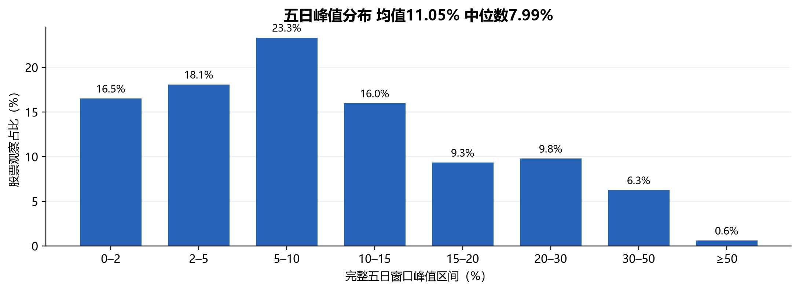

图10　柱形图按事先明确的涨幅区间汇总全部4,664个完整观察，最右侧包含50%及以上样本，不裁掉高峰值。观察数包含同一股票不同信号的重复，不能当作独立试验数量。

当前逐笔口径的三日触及5%比例为59.258%，市场为24.451%；十日峰值均值14.859%，市场为7.214%；单股次日上涨率为53.848%。窗口越长，最高价越容易提高，因此十日峰值高于五日并不自动说明十日持有更优。还需要比较等待时间、期间回撤和未达目标样本的最终结果。

### 3 高峰值与低到期表现为何可以同时出现

最高价描述窗口内曾到达的价格；到期价格只描述固定终点。股票可能先上冲后回落，因而峰值高而固定终点收益较低，二者不矛盾。本模型偏向寻找前者，采用峰值作为主要机会指标具有针对性，但如果据此研究卖出策略，仍须处理未触发退出、先跌后涨以及同日止盈止损顺序问题。

到期收益可以降低在选股评分中的优先级，却不能从交易结算中完全消失。未达到预设目标时，持仓最终如何处理、承担多少损失，是可执行收益的一部分。只保留达到目标的成功股票，会产生明显的幸存选择偏差。

## 十 隔夜贡献与可兑现程度

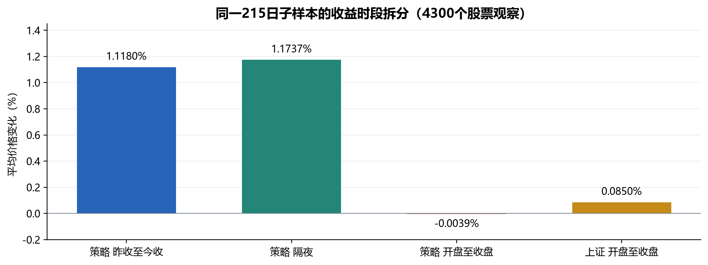

图11　固定215个完整交易日、4,300个股票观察，比较策略收盘至收盘、隔夜、开盘至收盘以及同期上证开盘至收盘。四根柱不是可相加的收益归因份额。

在该同一样本中，策略收盘至收盘均值约1.118%，隔夜均值约1.174%，开盘至收盘约−0.0039%；同期上证开盘至收盘约0.0850%。组合日内上涨日比例50.70%，单股日内上涨观察比例45.05%。这些结果共同说明，当前样本中最显著的单日强势已体现在高开阶段，次日开盘之后并没有同样明显的平均延续到收盘优势。

这不意味着五日上冲机会不存在，但改变了模型的用途解释。它更像是在历史上识别了容易在下一次开盘被重新定价的股票，以及后续仍可能出现高波动上冲的股票；它尚未证明开盘跟进能够复制昨收至今收的高收益。至于高开是否由消息、涨停延续或其他机制驱动，需要额外数据，不能仅凭价格拆分作因果归因。

我们还观察到，相关股票观察中约10.12%的开盘跳幅达到或超过9.5%。这不是经过涨跌停规则核对后的“涨停买不到比例”，不能直接等同于不可成交；但它提示开盘价格假设值得重点压力测试。下一阶段应增加成交可得性、委托排队、流动性和退出时点约束，而不是继续只优化事后峰值数字。

## 十一 预估情景曲线及其解释边界

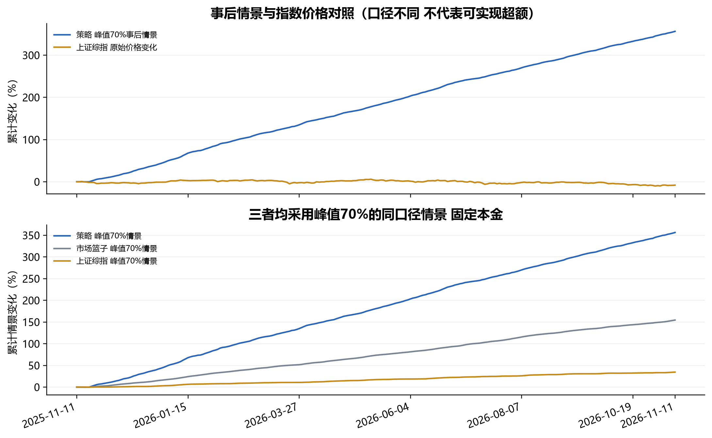

图12　上图按需求同时展示策略事后情景与同期上证原始价格变化，二者口径不同，差距不能解释为已实现超额；下图将策略、市场篮子和指数均放到峰值70%的同口径情景中。所有情景仍使用未来最高价。

指数原始价格曲线以测试段首日收盘价归一化，t₀表示区间起点，其累计价格变化定义为：

$$R^{I,\mathrm{cum}}_t=\frac{C^I_t}{C^I_{t_0}}-1$$

该曲线是价格参考，不含股息再投资，也不使用峰值卖出假设。当前测试段固定本金情景的累计变化分别为：策略356.36%、市场篮子154.46%、上证同口径情景34.55%。较高的市场篮子和指数情景结果说明，单是“事后按峰值打折退出”这一假设就能产生明显收益，不能把全部策略情景增长归因于选股能力。

策略平均每笔情景净收益约7.555%，与简单计算0.7×完整峰值均值再扣费略有不同，因为逐笔情景包含部分窗口、而完整峰值统计仅包含完整窗口。情景中有53个部分窗口，完整窗口4,664个，入场报价缺失取消23次。读者应先确认分母与窗口处理，再解释均值差异。

我们保留这组曲线，是为了清楚展示既有实验所计算的情景，而不是将其作为项目的盈利宣传。每日预测表现、未来上冲空间和事后资金情景在论文中分别成节，可以防止把同一个“收益”名称用于三个不同的问题。现实可执行净收益、年化收益、真实最大回撤和夏普比率在本轮尚不能可靠给出，不以情景指标替代。

## 十二 不确定性与数据质量核验

### 1 日期块重采样

相邻信号重叠、同一股票反复入选、股票间存在市场共同波动，因此不应把几千个观察全部视为独立样本。我们对日期序列进行圆形块重采样，以保留一部分时间相关性。每个块从随机交易日开始，连续取 ℓ 日，超过样本末尾则回到起点；拼接后截取原序列长度，保留缺失标记，计算有效日均值。

$$\bar D^{*(b)}=\frac{\sum_{t=1}^{T}m_t^{*(b)}D_t^{*(b)}}{\sum_{t=1}^{T}m_t^{*(b)}},\qquad m_t^{*(b)}=\mathbf{1}\{D_t^{*(b)}\ \mathrm{finite}\}$$

$$\mathrm{CI}_{95\%}=\left[Q_{0.025}(\bar D^*),\ Q_{0.975}(\bar D^*)\right]$$

重采样5,000次，核验随机种子20261113，块长度分别为5、10、20。对于日均相对上证优势，三种95%区间分别约为[0.888,1.463]、[0.902,1.449]、[0.906,1.452]个百分点。移除最大的五个超额日期后，平均超额仍约1.072个百分点。当前样本优势因而不完全由最好的几个日期解释，但这仍是既定已选模型的条件证据。

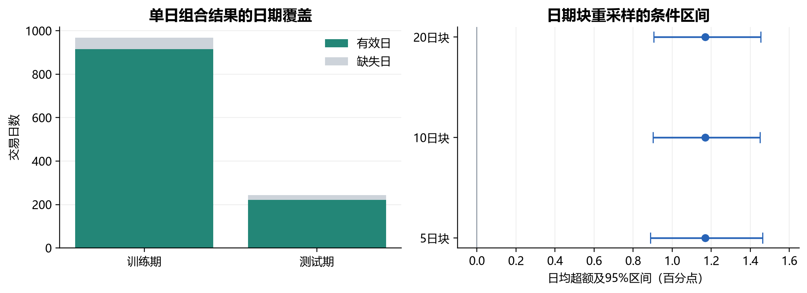

图13　左图显示完整与缺失日期，右图显示同一日均超额在不同块长度下的区间。区间没有对全部训练搜索、人工判断和重复查看历史作完整调整，不能解释为未来收益保证。

### 2 原研究中的多重比较处理

原权重研究对后段15组方案的峰值与辅助情景指标分别进行了 Holm 校正；每个指标内部处理15个比较，并没有覆盖所有指标之间、所有历史尝试之间的多重选择。若将同一组原始 p 值从小到大记为 p₍₁₎至p₍ₘ₎，校正形式为：

$$\widetilde p_{(k)}=\min\left\{1,\max_{j\leq k}\left[(m-j+1)p_{(j)}\right]\right\},\qquad m=15$$

这种调整并不能自动消除1,002组训练搜索中的赢家偏差，也不能使被多次查看过的后段重新成为盲测。本文把区间与校正作为统计描述的一部分，而不以单一 p 值宣告模型成立。优化权重相较等权的增量显著性，也不能由“各自显著优于市场”推导出来。

### 3 已核验项目与仍待解决的问题

本次结果整理核对了日期与模型键的唯一性、十五组权重和为1、已有汇总与逐日数据的一致性，并在215日子样本上将逐股收盘变化重新聚合，与保存的每日结果逐点对齐。原训练实现对标签数组先截断再计算，避免训练目标跨入测试期；本次整理没有重新搜索权重或重选方案。

尚未完成的内容包括完整历史退市池、所有公司行为和复权字段一致性、真实成交容量及历史可得性审计。报价缺失可能不是随机事件，完整样本结果也可能存在选择偏差。同池市场单日比较仅有107个共同完整日期，不能用它代替221日与上证对照的总体结果；本文主要机会基准则采用独立研究定义的同日有效市场篮子。

## 十三 模型优势与局限

模型的首要优势是透明和可分解。研究者可以从原始收盘价追踪到收益率，从收益率追踪到 P 与 Z，从每日得分追踪到五日加权及前20名，再从选股日期追踪到未来标签。每一步都有可以独立核验的数学定义，不需要依赖复杂模型的内部解释才能发现时间错位或分母变化。

第二个优势是比较意识明确。我们既与上证比较每日表现，也与同日股票篮子比较机会指标，并保留简单五日等权作为时间聚合基准。这使“跑赢指数”“优于同池市场”和“优化优于简单方案”成为三个独立问题，减少把市场整体上行误认为模型价值的风险。

第三个优势是研究目标与指标较匹配。模型关注短线上冲，峰值和触及频率能够直接描述机会空间，避免只用一个固定到期价格否定所有盘中机会。但匹配目标不意味着可以省略执行困难；模型输出仍只是候选排序与历史条件统计，不是实时卖出指令。

局限首先在于输入信息单一。P 和 Z 都由价格变化构成，缺少成交结构、风险暴露、信息事件和流动性层面的独立证据。横截面标准化也没有消除行业、市值或高波动偏好。若这些共同暴露解释了主要差异，模型就不能宣称发现独立于既有风格的收益来源。

其次，权重优化接近边界，训练候选之间的信息高度相关。近期权重较大可能反映当前样本特点，也可能受峰值目标偏向高波动股票的影响。只有增加纯单日、五日等权、不同波动分组和固定候选数量的对照，才能逐步解释机制。当前研究没有完成这些对照，不把它们写成已经得到的结论。

最后，峰值和每日收益都可能受报价及成交时点影响。尤其是隔夜贡献表明，最容易展示的强势不一定发生在能够入场之后。高峰值并不保证能够在峰值附近卖出，反复观测的测试成绩也不等于未来持续优势。我们因此将当前成果定为“具有研究价值、仍待执行验证”的探索性结果。

## 十四 后续实验与项目发展

### 1 冻结方案后检验可执行退出

下一轮应先冻结评分、权重、20只规则和股票池处理，再定义少量退出方案，避免同时改动所有环节。可以选择预先固定的目标触及事件、最长持有期限和保守结算规则，同时记录首次触及时点、此前最大不利波动以及未触及样本的结果。候选阈值属于新的实验设计，不是当前研究已验证的最优卖点。

日线最高与最低价不能恢复盘中先后顺序。若同日同时触及止盈和止损，应事先规定保守顺序或使用更细粒度行情；若涉及买入当日退出，应核对相应可卖约束。还需要对开盘不可得、停牌、价格限制、费用上调及容量进行压力测试。未触发目标的持仓必须结算，不能从统计中消失。

### 2 拆解时间权重的真正增量

我们建议固定同样的信号日期、基本股票池和20只数量，对照最新一天评分、五日等权与当前冻结权重。主要比较优化减等权的逐日期差值，而不只分别展示对市场的优势。在最新一天得分相近的股票之间比较此前四天表现，能够更直接回答旧信息是否有增量。

还可以预先设置最近一天权重上限、改变排序数量或比较稳健尺度，但应控制实验数量并保存全部尝试。若效果只在一个非常精确的参数点存在，研究结论应更谨慎；若简单方案在新增数据中持续接近复杂方案，则更简单、可解释的实现可能更值得保留。

### 3 新数据与开放研究

GitHub 项目的价值可以建立在清楚的研究问题、明确的计算契约和可以被检验的结果之上，而不必依赖夸张盈利结论。正文呈现设计到核验的完整过程，配套目录保存图表数据、参数、图表生成脚本和技术溯源。完整行情不是本报告的公开数据附件；数据来源、授权与历史覆盖应在后续整理中继续补全。

真正的确认阶段应使用未参与过方案选择的新数据，并预先指定主要指标和失败判据。若新增样本中相对机会差消失，或加入合理成交约束后净结果不再有利，我们应收缩模型主张。即便不能直接转化为策略，它仍可能有候选池排序和市场状态观察用途；这些用途同样需要分别验证。

## 十五 结论

我们从“个股相对于同期市场持续较强”这一想法出发，建立了收益排名、标准化偏离、五日约束加权和前20只排序的计算流程。通过前四年搜索和后一年时间留出评估，我们发现当前较优方案更偏重最近两天，且所选股票具有高于同日市场的短线上冲空间。完整展示十五个方案后，近期偏重不再只是第一名的个别现象，但仍属于当前目标和样本下的经验发现。

模型的有效性必须按层次讨论。已有结果支持相对强势和上冲机会识别；优化权重相较五日等权的附加价值较小，尚需单独确认；隔夜拆分则说明次日开盘进入不能自然取得主图中的全部优势。峰值70%曲线是帮助理解机会假设的事后情景，不是未来收益预测或可执行盈利证明。

下一步最有价值的工作不是继续追求更高的历史峰值，而是将机会标签转成事先可执行的规则，在新增数据中核验其收益、风险与成交条件。一个能够清楚说明如何设计、如何计算、哪里有效以及哪里尚不成立的研究项目，比只展示一条漂亮净值线更容易被复现、讨论和改进。

## 参考文献

[1] Jegadeesh N, Titman S. Returns to Buying Winners and Selling Losers Implications for Stock Market Efficiency. The Journal of Finance, 1993, 48(1): 65–91. https://doi.org/10.1111/j.1540-6261.1993.tb04702.x

[2] French K R. Description of Momentum Factors for Developed Markets. Kenneth R French Data Library. https://mba.tuck.dartmouth.edu/pages/faculty/ken.french/Data_Library/f-f_developed_mom.html （访问日期2026年11月13日）

[3] Bailey D H, Borwein J, López de Prado M, Zhu Q J. The Probability of Backtest Overfitting. 2017. DOI 10.21314/JCF.2016.322. 作者机构记录 https://scholarworks.wmich.edu/math_pubs/42/


## 补充讨论 理论优势与研究边界

### 1 当前证据支持的优势

我们认为，五日相对市场优势模型目前最值得重视的价值，是将一个直观的市场观察转化为可以定义、计算和核验的研究对象。个股相对同期股票的强弱，不再只由观察者凭印象判断，而是通过收益分布位置、标准化偏离和时间加权形成明确排序。这种表达使不同日期的强势状态具有可比较的依据，也使模型能够接受简单基准、样本外时段和后续消融实验的检验。

现有结果的吸引力不仅来自五日平均峰值超过10%，还来自相同口径下与市场篮子的差异，以及目标触及频率的同步提高。按原权重研究的后段日期等权口径，方案01五日平均峰值约11.09%，同日市场约4.95%；三日触及5%的比例分别约59.37%和24.51%。这组比较支持所选股票在本次历史样本中具有较突出的上冲机会。较高的机会空间与较高的触及频率共同出现，比单独展示一个较大的平均峰值更具有研究意义。

前十五个训练入围方案在后段保持相近的机会表现，也为继续研究提供了依据。它说明结果并非只在冠军那一组精确权重下出现，但这些方案仍来自同一搜索和同一历史样本，不能当作十五次独立验证。我们将其理解为有限范围内的参数稳定性线索，而不是已经证明跨时期、跨市场的普遍规律。

### 2 推进研究的意义

继续推进这一方向的意义，在于检验相对强势信息能否帮助缩小短线研究的候选范围，并辨认机会发生的时间位置。如果模型能够在新增数据中持续筛选出上冲频率较高的股票，它就可能为候选池排序、信号比较和退出规则研究提供有用基础。筛选器本身可以具有信息价值，即使其输出尚不能直接转化为完整交易策略；具体用途的有效性仍需要逐项确认。

本次研究还提供了一个重要的经验线索：在既定评分与峰值目标下，较好的训练配置偏向最近两天。这一发现可以指导下一阶段的问题设计，例如比较纯单日与五日等权、检验较早四天是否有独立增量，以及分析近期权重为何接近约束边界。权重搜索得到的是经验偏好，不是因果效应；其价值在于提出更精确、可被否定的新问题。

我们也需要区分核心筛选思想与参数优化的价值。五日等权方案已获得约10.52%的后段平均峰值，优化方案约11.09%，附加改善约0.57个百分点。当前较强的证据更多支持相对强势筛选框架，尚不能把全部效果归功于精细的五日权重。若后续发现简单方案同样稳定，保留简单方案本身也可以是有价值的研究成果。

### 3 当前阶段的明确定位

本文属于理论建模与历史统计验证阶段。这里的理论，是对相对优势、评分和机会标签的明确构造，以及由此提出的可检验猜想；它不是已经通过数学证明或实盘验证的收益定律。历史数据为猜想提供经验支持，但不能仅凭一次较好的时间留出结果认定其已经成立。本研究可以据此评价机会识别表现，尚不能给出可靠的未来可执行收益预期。

我们所称的统计优势，始终附着于明确的样本、参照组、窗口和聚合口径。五日峰值表示窗口内曾出现的最高价格空间，不是预先知道的卖出点；历史触及频率不是经过校准的未来概率。峰值70%情景依赖事后最高价，即使设置折扣并扣除统一费用，仍不能将其累计结果解释为投资者能够取得的利润。这一限制是情景定义本身的性质，不能笼统地归结为实际交易中存在少量误差。

### 4 风险与可能推翻结论的条件

首先，显著的单日相对优势主要集中于隔夜。相同215日子样本的开盘至收盘平均涨跌接近零，说明次日开盘进入并不自然继承主图中的全部优势。其次，重复查看后段、参数搜索、历史股票池存续偏差、复权与缺失报价处理，均可能影响统计结果。代码正确只是必要条件，不能代替数据质量、时点可得性和研究选择偏差的审计。

同时，上冲空间不刻画持有过程中的全部损失。股票可能先大幅下跌再冲高，也可能在短暂高点后回落；成交价格、可卖时点、流动性及费用会进一步影响兑现程度。我们因此需要继续检验最大不利波动、未触及目标样本的结算结果及真实成交约束，而不能只增加成功上冲的展示。较高机会指标与较高风险完全可能同时存在。

如果冻结规则后的新增样本不再保持相对机会差，或在合理的数据与成交假设下优势明显消失，我们就应降低对模型的评价，并修正或放弃相应主张。若机会识别继续有效、交易兑现却不成立，则应将结论限定在筛选与研究用途。我们希望强调的，是现有统计表现值得认真推进，同时允许后续证据改变结论；研究价值来自可核验的发现和清楚的边界，而不取决于预先保证模型一定成功。
